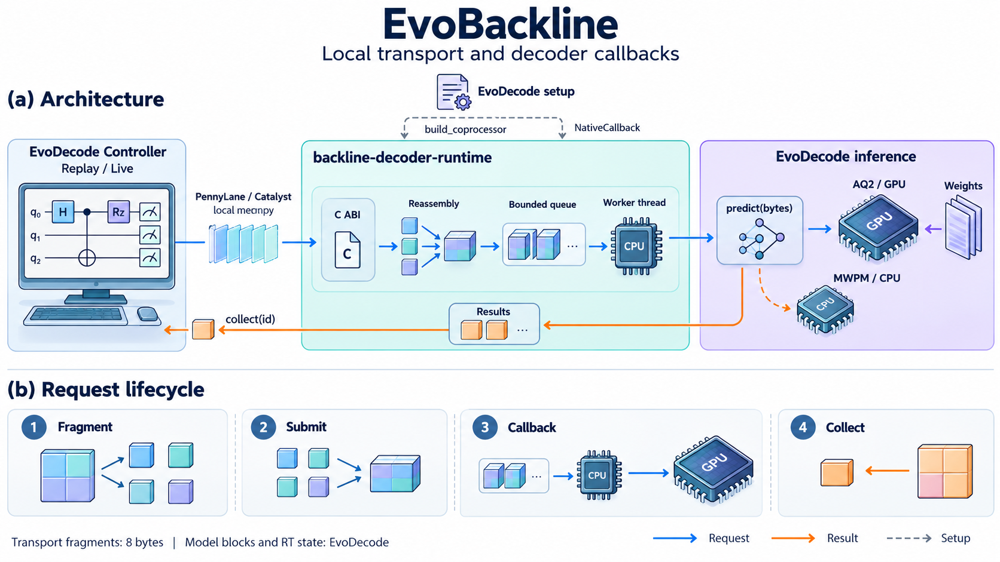

# 维护 EvoBackline runtime

从 [C++ 队列](../packages/decoder-runtime/src/backline_decoder_runtime/coprocessor.cpp) 查看请求怎样分片、排队并按编号收集；从 [NativeCallback](../packages/decoder-runtime/src/backline_decoder_runtime/native_callback.py) 查看回调注册、异常与清理。[构建函数](../packages/decoder-runtime/src/backline_decoder_runtime/build.py) 把原生库编译到调用方指定的目录。

## 与 EvoDecode 的分工

| 工作 | 维护位置 |
| --- | --- |
| 原生请求分片重组、有界任务队列、结果收集 | 本仓库的 `packages/decoder-runtime/` |
| Python 回调注册、错误记录和退出清理 | 本仓库的 `packages/decoder-runtime/` |
| Controller/Coprocessor 配置及实际传输执行 | PennyLane/Catalyst；本仓库保留演示和构建配置 |
| 帧格式、输入转换、回放和实时数据生成 | EvoDecode |
| AQ2/Ising 模型构造、权重加载、CPU/GPU 推理 | EvoDecode |
| 实验配置、预测对比和结果报告 | EvoDecode |

共享包接收字节数据，调用应用提供的 Python 函数，当前回调要求返回 **0 或 1**。
它不解释数据对应哪种模型，也不决定模型如何分块推理。
旧的 EvoDecode 专用演示和模型适配器已经移除，本仓库不分发模型权重或本地实验结果。

## 结构与调用流程



[查看高清原图](../assets/evobackline-architecture.png)。上图展示当前 EvoDecode 的本地
`memcpy` 接入：Controller 发送数据，共享包重组分片、排队并调用 EvoDecode 的
`predict` 回调，完成后按请求编号取回结果。CPU Coprocessor 承接回调，AQ2 的
张量计算仍在 GPU 上执行；权重和 RT 跨块状态由 EvoDecode 管理。

图示省略了返回路径上的工作线程和传输层细节。传输分片每次携带 8 字节，
与模型的帧块不同；RT 中间块返回的 0 是占位确认，最终块才返回 shot 预测。
本地无权重示例直接调用 C 入口；RDMA/FPGA 属于另行配置的上游硬件演示。

## 仓库内容

| 路径 | 用途 |
| --- | --- |
| [`packages/decoder-runtime/`](../packages/decoder-runtime/README.md) | 本分支维护的共享运行包及协议测试 |
| [`demos/demo_decoder_callback.py`](../demos/demo_decoder_callback.py) | 不依赖模型的本地回调示例 |
| [`demos/`](../demos/README.md) | 保留的上游 CPU、GPU、RDMA 和 FPGA 演示 |
| [`config/xbuild/`](../config/xbuild/README.md) | 上游构建系统与目标机器配置 |
| [`config/machines.toml`](../config/machines.toml) | 硬件演示使用的机器配置 |
| [`benchmarks/`](../benchmarks/README.md) | 上游测量程序与使用说明 |
| `data/`、`assets/` | 上游实验数据及配图 |
| `scripts/` | 演示与测量辅助脚本 |

运行硬件演示时，按 [`INSTALL.md`](../INSTALL.md) 准备对应的
PennyLane/Catalyst、网络和设备，再按[演示说明](../demos/README.md)执行。
这些依赖与上面的独立回调示例不同。
上游论文中的延迟测量属于其指定硬件和实验条件，不作为本分支或 EvoDecode 模型的性能承诺。

## 日常开发

开发者可在两项目共用的开发环境中执行：

```bash
python -m pip install --no-deps --no-build-isolation -e ./packages/decoder-runtime
```

源码修改即可被新的 Python 进程使用；已编译原生库在下一次运行时重新生成。
不要把开发环境的 editable 路径作为用户安装依赖。

## 构建与验收

从仓库根目录构建候选包，安装到用于测试的虚拟环境。

```bash
python -m pip wheel --no-deps --no-build-isolation ./packages/decoder-runtime --wheel-dir ./dist
python -m pip install --force-reinstall --no-deps ./dist/backline_decoder_runtime-0.1.0-py3-none-any.whl
python -m unittest discover -s packages/decoder-runtime/tests -v
python demos/demo_decoder_callback.py
```

修改 xbuild 时按[子目录规则](../config/xbuild/AGENTS.md)验证相应目标。协议测试覆盖分片、队列、回调错误与清理；跨库验证还要在 EvoDecode 运行 SDK 回放。

## 版本与发布

此分支在提交 `d89284e` 中声明 runtime `0.1.0`。[EvoDecode](https://github.com/qhub-cn/evo-decode) 提交 `ceb9776` 的依赖清单与之匹配。
发布时在你自己的 Backline fork 中审核、提交、测试，再按 Git 规范创建语义化版本
附注 tag，并把 wheel 和 SHA256 上传到对应 Release。不要使用官方项目的发布地址
冒充自己的包，也不要覆盖已经发布的同版本文件。

共享代码有修改时，更新本仓库包版本并测试；EvoDecode 更新 optional dependency、
CPU 清单及安装脚本中的期望版本，安装新的 wheel 后运行集成测试。涉及协议变化时
需要同时更新调用方，不能只改版本号。

测试：`tests/test_protocol.py` 和从演示迁入的 `tests/test_adapter.py` 共 15 项，
验证分片、ABI、队列容量、shot ID、回调错误、线程与清理。EvoDecode 保留自己的集成测试。
源码继承 Apache-2.0 许可，见 [LICENSE](../packages/decoder-runtime/LICENSE) 和包内 [NOTICE](../packages/decoder-runtime/src/backline_decoder_runtime/NOTICE)。

[构建元数据](../packages/decoder-runtime/pyproject.toml) · [协议测试](../packages/decoder-runtime/tests/test_protocol.py) · [回调测试](../packages/decoder-runtime/tests/test_adapter.py)

## 历史验证（2026-09-28）

0.1.0 wheel 已构建并供两个项目安装。包协议测试 3 项、Backline 原演示适配测试
12 项、EvoDecode CPU 集成测试 26 项通过。错误版本 wheel 会在创建环境前被
EvoDecode 安装脚本拒绝。wheel 尚未上传；正式发布应从干净源码构建，保留 SHA256。

Backline 构建检查：`make check` 通过；补齐系统 rsync 后，`make test` 为 169 通过、0 失败、2 跳过（非 macOS 无法测 Mach-O；本机有 clang，无法模拟缺失工具链）。两个独立安装包在仓库外完成 32-shot CPU 示例，pip check 通过。
