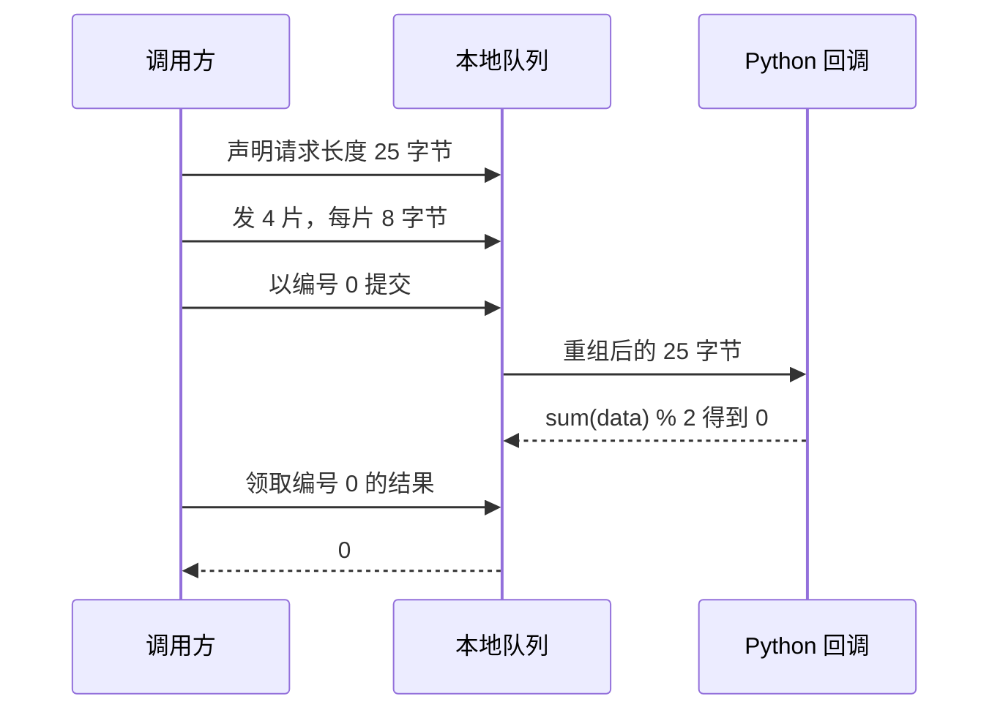

# backline-decoder-runtime 用户指南

应用提交一个字节请求，runtime 将分片重组并放入本地队列。Python 回调收到完整的 `bytes`，返回 0 或 1。调用方按请求编号领取结果。

<a id="构建与安装"></a>

<a id="运行第一个回调"></a>

## 本地回调示例

从源码安装并运行的命令见[仓库首页](https://github.com/nemoo138/backline/blob/evobackline/README.md#本地回调示例)。如果手头已有 0.1.1 wheel，在 Linux 上激活 Python 3.11+ 虚拟环境，进入 wheel 所在目录后运行以下命令。示例启动时需要支持 C++20 的 `c++` 编译器。

```bash
python -m pip install ./backline_decoder_runtime-0.1.1-py3-none-any.whl
python -m backline_decoder_runtime.demo
```

每个请求含 25 个有效字节。发送端将末片补齐到 8 字节，回调只收到原始的 25 字节。示例先提交两条，再依次领取。下图展开第 0 条请求。



第一个请求的字节从 0 到 24，总和为 300。第二个请求把首字节改成 1，总和为 301，因此两次回调分别返回 0 和 1。`PASS` 表示示例已核对结果和回调实际收到的字节。原生库在临时目录中编译，示例退出后清理。

## 在 Python 中接入应用

应用提供的回调接收一个完整的 `bytes` 请求，返回整数 0 或 1。例如，下面的函数可以直接替换本地回调示例中的 `lambda data: sum(data) % 2`：

```python
def parity(data: bytes) -> int:
    return sum(data) % 2

assert parity(bytes(range(25))) == 0
assert parity(bytes([1]) + bytes(range(1, 25))) == 1
```

在示例的 `with NativeCallback(bridge, parity, request_size=25, queue_depth=2) as binding:` 中，`bridge` 是已加载的共享库，`request_size` 是回调期望收到的有效字节数，`queue_depth` 是最多可同时占用的请求槽数。将原来的提交和领取代码保留在 `with` 块内。分片、提交编号和领取结果的完整写法见 [demo.py](https://github.com/nemoo138/backline/blob/evobackline/packages/decoder-runtime/src/backline_decoder_runtime/demo.py)。

如果收到的长度不符、回调抛出异常，或返回值转换成整数后超出 0、1，绑定会将异常堆栈记录在 `binding.error`。排查时先看这里。共享库的入口签名和会话清理见[开发者指南](https://github.com/nemoo138/backline/blob/evobackline/docs/developer.md)。

<a id="两个仓库如何使用"></a><a id="职责边界"></a>

## 在 EvoDecode 中部署

按所用 EvoDecode 版本的 `backline` 可选依赖选择 runtime wheel。配套的部署手册给出了两个 wheel 的安装命令、同一会话连续回放两批的示例，以及实时测量示例。输入帧、模型权重和 `Deployment` 参数均由 EvoDecode 管理。[EvoDecode 部署手册](https://github.com/qhub-cn/evo-decode/blob/main/docs/user/deployment.md)

<a id="日常开发"></a><a id="版本与发布"></a><a id="本次验证2026-09-28"></a>
