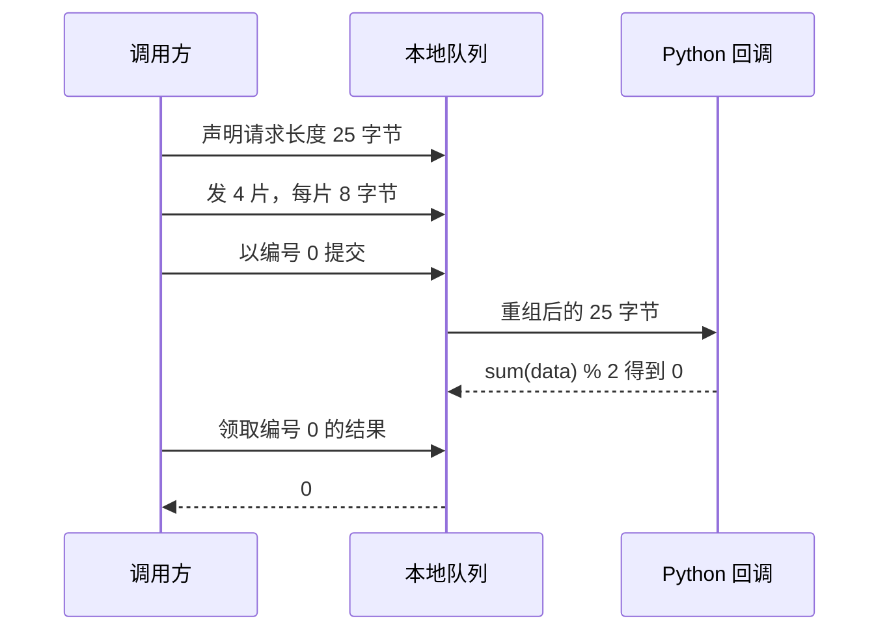

# backline-decoder-runtime 用户指南

应用提交一个字节请求，runtime 将分片重组并放入本地队列。Python 回调收到完整的 `bytes`，返回 0 或 1。调用方按请求编号领取结果。

<a id="构建与安装"></a>

## 运行第一个回调

需要 Linux、Python 3.11+ 和支持 C++20 的 `c++` 编译器。请将下方路径换成本地 wheel 的位置。示例只使用 CPU 和 Python 标准库。

```bash
python3 -m venv .venv
source .venv/bin/activate
python -m pip install ./backline_decoder_runtime-0.1.1-py3-none-any.whl
python -m backline_decoder_runtime.demo
```

```text
request 0: 25 bytes, result=0
request 1: 25 bytes, result=1
PASS: fragmentation, queue, callback, and result collection
```

每个请求含 25 个有效字节。发送端将末片补齐到 8 字节，回调只收到原始的 25 字节。示例先提交两条，再依次领取。下图展开第 0 条请求。



第一个请求的字节从 0 到 24，总和为 300。第二个请求把首字节改成 1，总和为 301，因此两次回调分别返回 0 和 1。`PASS` 表示示例已核对结果和回调实际收到的字节。原生库在临时目录中编译，示例退出后清理。

<details>
<summary>从源码安装</summary>

在仓库根目录运行，随后使用上面相同的示例命令。

```bash
python -m pip install ./packages/decoder-runtime
```

</details>

## 在 Python 中接入应用

`build_coprocessor(path)` 在指定位置编译共享库，`NativeCallback` 在 `with` 期间绑定应用函数。安装包中的 `backline_decoder_runtime.demo` 给出了用 ctypes 提交请求和领取结果的完整示例。下面只编译共享库，打印其实际路径。

```python
from pathlib import Path
from backline_decoder_runtime import build_coprocessor

library = build_coprocessor(Path("run/libdecoder.so"))
print(library)
```

<a id="两个仓库如何使用"></a><a id="职责边界"></a>

## 在 EvoDecode 中部署

按所用 EvoDecode 版本的 `backline` 可选依赖选择 runtime wheel。配套 SDK 的 `docs/user/deployment.md` 包含双 wheel 安装命令、同一实例连续回放两批以及实时测量示例。输入帧、模型权重和 `Deployment` 参数均由 EvoDecode 管理。[EvoDecode 部署入口](https://github.com/qhub-cn/evo-decode#backline)

<a id="日常开发"></a><a id="版本与发布"></a><a id="本次验证2026-09-28"></a>
